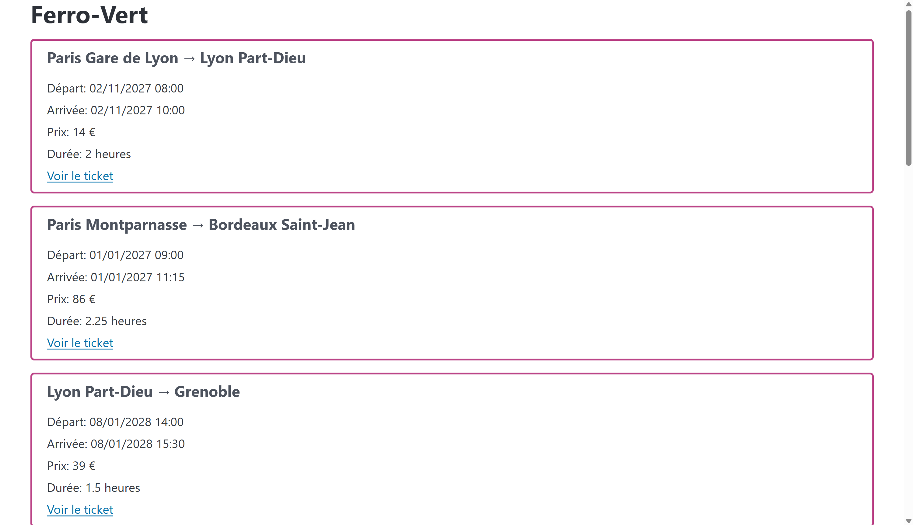
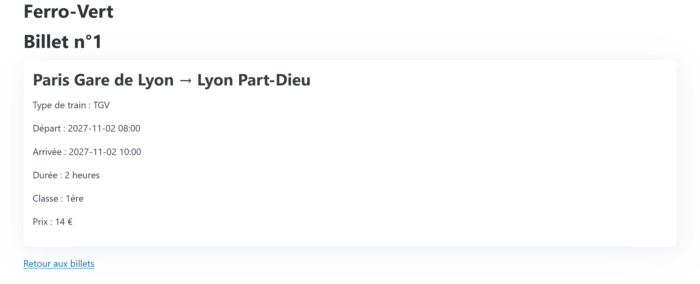

# **GL03** - Réduction de l’impact écologique d’un service numérique de réservation de billet de train : Ferro-Vert 

## Choix du sujet 

Au quotidien, nous prenons le train environ 2 fois par mois, et plus pendant les vacances. Pour réserver ces trains, nous passons par l’application SNCF Connect sur notre téléphone. 

A l’échelle globale en France, 5 millions de personnes prennent le train par jour*, et la majorité de ces passagers utilisent l’application SNCF Connect pour réserver leur billet, le scanner en gare et rester au courant des retards des trains. 

Avec autant d’utilisateurs, l’application se doit d’être la plus neutre en carbone possible. C’est pourquoi nous avons choisi de travailler sur cette application afin de baisser son impact. 

*Source : la [SNCF](https://www.sncf-voyageurs.com/fr/decouvrez-notre-entreprise/sncf-voyageurs/nous-comprendre/) 

## Utilité sociale 

SNCF Connect est aujourd’hui un service incontournable pour prendre le train en France. Grâce au train, les voyages sont accessibles à ceux qui n’ont pas de voiture. Afin de proposer plus d’options de prix et de moyens de transport, l’application propose aussi des bus et du covoiturage. 

Le train remplace la voiture mais aussi l’avion, par exemple pour des trajets comme Paris - Londres, Paris - Bruxelles, vers les grandes capitales d’Europe reliées en train. 

Les utilisateurs peuvent acheter des billets, souscrire à des cartes de réduction, rechercher des itinéraires, s’informer en direct sur leurs trajets. Elle s’utilise à la fois pour les déplacements du quotidien mais aussi pour les voyages et pour les trajets de courte ou longue distance. L’ensemble des éléments sont ainsi dans notre poche, permettant d’y accéder à tout moment. 

Avec la situation actuelle en France, que ce soit écologique ou politique, il est nécessaire de mettre en avant des moyens de transport plus responsables que la voiture et l’avion, comme le train. Avec la hausse du prix du carburant et le réchauffement climatique, il faut orienter et informer les gens sur l’option du train, et rendre le train accessible à tous. 
En France, 55% du réseau ferré est éléctrifié ([source](https://fr.wikipedia.org/wiki/%C3%89lectrification_du_r%C3%A9seau_ferr%C3%A9_en_France)), et le mix énergétique français est décarboné à plus de 95% ([le réseau de Transport d'Electricité](https://www.rte-france.com/actualites/bilan-electrique-2025-conditions-sont-reunies-permettre-france-accelerer-electrification)). Le train est donc la solution la plus écologique.

## Effets de la numérisation 

La numérisation de la réservation de trains et des billets fait que ces derniers ne plus imprimés automatiquement, bien qu’ils restent imprimés parfois par les générations plus âgées sur du papier d’imprimante classique : étant donné que c’est aujourd’hui une minorité des cas, on négligera ce cas. De plus, les billets prenables en gare sont sous forme de ticket de caisse. 

Le bilan en impact écologique de la substitution des billets papiers / tickets par le numérique est difficile à établir. On estime : 

Un billet papier de type ticket de caisse “émet” environ 2g de gaz à effet de serre et 5cl d’eau, tandis qu’un mail avec un billet dématérialisé c’est 5g de gaz à effet de serre et 3cl d’eau (source : La fin du ticket de caisse en papier est-elle vraiment une bonne idée pour <u>la planète ? — Vert ). A cela il faut ajouter l’impact de consultation d’une page Web, assez</u> faible (environ 1g), c’est donc à peu près équivalent. Cependant, si l’utilisateur parcourt de nombreuses pages avant de réserver son train, le numérique peut davantage polluer. 

Aussi, l’application remplace le fait de devoir aller en gare afin d’acheter ses billets, empêchant la pollution de transports, et facilitant la réservation de train. Les gens prennent donc leur billet de moins en moins à la dernière minute et sont plus sereins. Elle permet aussi de faire des économies de papier pour les billets et les cartes. La numérisation permet de désengorger les gares. 

## Scénarios d'usage et impacts 

Nous faisons l’hypothèse que l’utilisateur ouvre une fois l’application pour consulter les billets possibles, comme nous le faisons souvent, pour consulter les horaires et les prix, et dans le second scénario il réserve une option posée précédemment, il paie, et il télécharge son billet 

## Scénario 1: consulter les horaires 

1. L’utilisateur se rend sur son application de train préférée grâce à un favori (donc sans passer par un moteur de recherche). Si nécessaire, il donne son consentement. 

2. Ensuite il entre sa ville d’arrivée, puis sa ville de départ (il choisit d’y aller mercredi à 10h). Puis il clique sur chercher.

3. Il consulte les horaires disponibles. 

## Scénario 2 : réserver une option posée 

1. L’utilisateur se rend sur la SNCF Connect grâce à un favori (donc sans passer par un moteur de recherche). Si nécessaire, il donne son consentement 

2. Il va dans les options posées 

3. Il choisit le trajet qu’il veut payer 

4. Il procède au paiement 

5. Il télécharge et consulte son billet 

## Impact de l'exécution des scénarios auprès de différents services concurrents 

L'EcoIndex d'une page (de A à G) est calculé (sources : [EcoIndex](https://www.ecoindex.fr/comment-ca-marche/), [Octo](https://blog.octo.com/sous-le-capot-de-la-mesure-ecoindex), [GreenIT](https://github.com/cnumr/GreenIT-Analysis/blob/acc0334c712ba68939466c42af1514b5f448e19f/script/ecoIndex.js#L19-L44)) en fonction du positionnement de cette page parmi les pages mondiales concernant :

- le nombre de requêtes lancées,
- le poids des téléchargements,
- le nombre d'éléments du document.

Nous avons choisi de comparer l'impact du scénario 1 des services de réservation de trains en France : [SNCF Connect](https://www.sncf-connect.com/), [1 2 Train](https://www.12train.com/), [Trainline](https://www.thetrainline.com/fr), [Trenitalia](https://trenitalia.fr/), [Renfe](https://www.renfe.com/es/fr), [RATP](https://www.ratp.fr/), et [Transilien](https://www.transilien.com/fr), qui est particulier car on peut seulement consulter les horaires et les dernières informations dessus : on ne peut pas réserver.

Le scénario 2 était plus compliqué à appliquer pour nous dans la mesure où il faut acheter un billet pour le vérifier. Cependant, le scénario 1 était suffisant pour avoir un avant goût des pratiques à adopter ou à éviter.

|Service|Score|Classe|Détails|
|---|---|---|---|
|SNCF Connect|18,59/100|F|[...](./benchmark/SNCF/SNCFConnect.md)|
|1 2 Train|82/100|A|[...](./benchmark/12Train/12Train.md)|
|Trenitalia|20,2/100|F|[...](./benchmark/Trenitalia/Trenitalia.md)|
|Renfe|18/100|F|[...](./benchmark/Renfe/Renfe.md)|
|RATP|23,3/100|F|[...](./benchmark/RATP/RATP.md)|
|Trainline|24/100|F|[...](./benchmark/Trainline/Trainline.md)|
|Transilien|13,03/100|F|[...](./benchmark/Transilien/Transilien.md)|

*Tab 1 : Mesure de l’EcoIndex de la page d’accueil des services de réservation de trains en France.*

Les données des sites 12Train, Renfe et Trainline ont été réalisé avec l'outil EcoIndex. Les sites SNCFConnect, Trenitalia, RATP et Transilien ont été réalisé avec le plugin GreenIT Analysis car ces derniers sont protégés (protection antibot) et étaient inaccessibles pour l'outil.

Dans le détail, les pages d’accueil qui ont les plus mauvais scores sont celles qui incluent : 

- Beaucoup d’images (même optimisées, elles peuvent avoir un impact négatif) 

- Beaucoup de requêtes (pour les traqueurs et les publicités) 

Parmi les services, on remarque “1 2 Train”, qui nous montre qu’il est possible d’améliorer son EcoIndex (A). Même si le site a fait le choix d’être très minime visuellement et dans les fonctionnalités, il reste facile d’utilisation et garde le nécessaire à la réservation de train. Il faut limiter au maximum l'utilisation d'images, et les garder uniquement lorsque c'est vraiment nécessaire : pas seulement mettre des images pour rendre le site visuellement agréable.

## Modèle économique 
Comme nous l'avons vu dans la section précédente, parmi les choix de conception ayant le plus d'impact environnemental, la plupart sont directement liés au modèle économique du service. C'est pourquoi il est nécessaire à ce stade d'analyser leur modèle économique et de définir notre propre modèle permettant une conception plus frugale.

|Service|Visiteur anonyme|
|---|---|
|SNCF Connect|● Publicités (régie intégrée/ partenariats et régie tierce) ● Ventes de billet|
|12 Train|- commission versée par SNCF Voyageurs sur chaque billet vendu (6 centimes par billet) - [https://www.linkedin.com/in/jeanbaptistemarie](source)|
|Trenitalia|● Publicités (régie intégrée) ● Ventes de billet|
|Renfe|● Ventes de billet|
|RATP|● Publicités (régie intégrée) ● Ventes de billet|
|Trainline|● Commissions (5% du prix du billet) ● commission versée par SNCF Voyageurs sur chaque billet vendu (6 centimes par billet)|

Tab. 2 : Offre des services de réservation de train (sans transilien car on ne peut pas réserver dessus).

On voit que la grande majorité des services de réservation de train fonctionnent par la vente de leurs billets, car c’est le site de la compagnie qui gère les trains.
Il faut donc que nous choisissons si on se positionne comme une entreprise qui gère les trains et son propre site, ou si on se positionne comme un revendeur (qui donc ne récupère pas le prix du billet).
Il y a seulement Trainline et 12Train qui sont différents : Trainline ajoute une commission de 5% du prix du billet. 12 Train récupère uniquement la commission reversée par SNCF Voyageurs, ce qui fait que le créateur gagne très peu (6 centimes par billet).

|Source possible de revenus|Montant unitaire|Quantité nécessaire pour financer un 1 salaire|
|---|---|---|
|Affichage d'une publicité (régie tierce)| 0,00046€|7 758 696|
|Diffusion d'une publicité (régie intégrée)|10 000€|0,35|
|Etre le vendeur de billet Commission de SNCF|le prix du billet (45 euros en moyenne, source : [https:// www.vacancesmania.co m/france/quel-est-le-prix- moyen-dun-billet-de-train -en-france/](vacances mania)) 0,06 centimes / billet|59 483 billets vendus par mois|
|Commission de notre site|5% du billet|1590 billets vendus par mois|

Tab. 3 : Source de revenus possibles pour le service d’une réservation de train

L'étude de l'offre des quotidiens nous a permis d'identifier les sources de revenu communément utilisées (cf Tab. 2). Associées à un bref état de l'art (cf. Tab.3), nous avons pu établir que :

1. Pour les entreprises qui gèrent les trains et leur propre site (SNCF Connect, Renfe, Trenitalia, RATP), la majorité de leur source de revenue est le prix du billet de train
2. Pour les revendeurs (Trainline et 12Train), on ne récupère pas le prix du billet mais une faible commission de la part de SNCF Voyageur, ce qui est un petit revenu, donc Trainline prend une commission en plus afin de faire du bénéfice
3. un modèle par commissions semble adapté à financer les salaires de ceux qui maintiendront la plateforme

Nous avons choisi le modèle économique de commissions, semblable à la plateforme Trainline. 

Nous prenons une commission égale à 5% du prix du billet de train.

Par conséquent, pour réduire l'impact écologique du service, nous proposons de :
- de renoncer aux publicités gérées par une régie tierce ou intégrée,
- d'adopter un modèle basé sur les commissions de 5% sur chaque billet (+ la commission donnée par SNCF Voyageurs, qui est plutôt faible),

## Maquette de l'interface et échantillon de données 
Au vu des différents services comparés, des exigences environnementales exprimées plus haut et des scénarios retenus, nous avons défini pour notre prototype une maquette de l'interface et un échantillon de données réalistes.

Les ressources Web possédant une représentation sur notre application seront :

- la page de recherche d'un trajet (avec une HTTP-URI ayant pour chemin `/`)
- un résultat de recherche avec plusieurs trajets correspondants (avec pour chemin `/{parametresDeRecherche}`).
- une page de détails avant paiement d'un trajet (avec pour chemin `/{numéroDeTrajet}`).
- une page pour afficher ses différents billets (avec pour chemin `/{mesBillets}`).

 <br>
__Fig.1__ : Maquette de l'interface du prototype : __a.__ Page d'accueil de recherche<br>


<br>
__b.__ Résultats de la recherche, affichage des différents trajets possibles<br>


<br>
__c.__ Ouverture des détails de la recherche<br>


<br>
__d.__ Détails du voyageur et du trajet avant le paiement<br>


<br>
__e.__ Affichage de ses billets<br>

Pour les données utilisées, nous avons utilisé le modèle ci-dessous. Nous en avons généré 10, et avons veillé à ce que l'arrivée soit bien après le départ. Nous avons essayé de créer des données avec une structure similaire à celle utilisée par les services concurrents : gare de départ, gare d'arrivée, type de train, jour et heure de départ et d'arrivée, prix, durée, classes disponibles.

```
{{#*inline "ticket"}}
{
"trainStationDeparture": "{{trainStationDeparture}}",
"trainStationArrival": "{{trainStationArrival}}",
"trainType": "{{random 'TGV' 'TER' 'Intercités' 'Eurostar' 'ICE'}}",
"scheduleDeparture": "{{travelDate}} {{departureTime}}",
"scheduleArrival": "{{travelDate}} {{arrivalTime}}",
"class": "{{random '1ère' '2ème'}}",
"price": {{int minPrice maxPrice '0'}},
"duration": {{duration}}
}
{{/inline}}
{
"tickets": [
{{#repeat 2}}
{{#with (date '2026-11-07' '2027-10-08' 'YYYY-MM-DD') as |travelDate|}}
{{> ticket travelDate=travelDate
trainStationDeparture='Paris Gare de Lyon' trainStationArrival='Lyon Part-Dieu'
trainType=trainType departureTime='08:00' arrivalTime='10:00'
minPrice=35 maxPrice=95 duration=2}},
{{> ticket travelDate=travelDate
trainStationDeparture='Paris Montparnasse' trainStationArrival='Bordeaux Saint-Jean'
trainType=trainType departureTime='09:00' arrivalTime='11:15'
minPrice=39 maxPrice=99 duration=2.25}},
{{> ticket travelDate=travelDate
trainStationDeparture='Lyon Part-Dieu' trainStationArrival='Grenoble'
trainType=trainType departureTime='14:00' arrivalTime='15:30'
minPrice=18 maxPrice=35 duration=1.5}},
{{> ticket travelDate=travelDate
trainStationDeparture='Paris Bercy' trainStationArrival='Clermont-Ferrand'
trainType=trainType departureTime='18:00' arrivalTime='21:30'
minPrice=25 maxPrice=75 duration=3.5}},
{{> ticket travelDate=travelDate
trainStationDeparture='Nantes' trainStationArrival='Rennes'
trainType=trainType departureTime='11:30' arrivalTime='13:00'
minPrice=15 maxPrice=30 duration=1.5}}
{{/with}}
{{/repeat}}
]
}
```

## Implémentation du scénario prioritaire 
### Etape de prototypage : Données chargées de manière statique
Pour cette première version du prototype (v1.0.0) :

- L'échantillon de données est encore chargé dans le code de manière statique
- Nous avons uniquement implémenté la visualisation des résultats d'une recherche, et la visualisation des détails d'un ticket
- Nous n'avons pas implémenté encore la recherche d'un ticket avec les différents champs (date, heure, départ et destination) : étant débutants, nous prenons d'abord en main React, et nous implémenterons la recherche dans un second temps
- Ce scénario nécessite de pouvoir naviguer entre deux types de page : la page de résultats de la recherche et la page de visualisation d'un ticket

### Page de résultats de recherche
Nous avons développé la page de résultats de recherche (cf. Fig. 2) pour qu'elle affiche l'échantillon de données sous une forme proche de ce que prévoyait la maquette.


Fig.2 : Prototype de la page de résultats de recherche

Pour l'instant, nous avons choisi un framework de mise en page minimaliste (PicoCSS). Dans la suite du projet, nous verrons si l'impact environnemental du passage à un framework de mise en page plus puissant (comme Bootstrap) est possible, et si nous en trouvons le besoin.

Nous avons ajouté la bibliothèque DayJS afin d'afficher les trains ayant lieu le lendemain différement (il est marqué "Demain" au lieu de la date pour être plus lisible).

Dans l'état actuel du prototype, il est possible d'avoir une première idée de l'impact environnemental du frontend. Il manque encore le chargement dynamique des données, mais nous pouvons déjà évaluer l'impact de l'affichage des données et du framework (React, PicoCSS, DayJS). 

<!--Cette évaluation de l'impact (cf. Tab.4) est déjà encourageante en mode "développement" mais encore plus en mode "pré-production". --> 


|   | EcoIndex| GES (gCO2e) | Taille du DOM | Requêtes | Taille de la page (ko)
|---|--------:|------------:|--------------:|---------:|---------------------:
| Mode "développement"  | 89 A 🟩 |  1.2 | 87 | 25 | 2 (5605)
| Mode "pré-production" | 88 A 🟦 | 1,2 | 190 | 4 | 125

Tab. 4 : Evaluation de l'impact du prototype de la page d'accueil

# Page des détails d'un ticket
Les pages des articles ont pour HTTP-URI /{id}. L'échantillon de données donne un id pour chaque ticket proposé.

De même que précédemment, nous avons tenté d'implémenter cette page (cf. Fig. 3) conformément à ce que prévoyait la maquette. 


Fig. 3 : Prototype de la page de détails d'un ticket

Avec l'ajout de ce modèle de page et la mise en place de la navigation entre les deux pages, il devient possible d'exécuter le scénario prioritaire (hors recherche) et de mesurer son impact.

|   | EcoIndex| GES (gCO2e) | Taille du DOM | Requêtes | Taille de la page (ko)
|---|--------:|------------:|--------------:|---------:|---------------------:
| 0. Page d'accueil et lancement d'une recherche (pas implémenté)	   |  |  |  |  | 
| 2. Visualisation des trains possibles		   | 89 A 🟩 |  1.2 | 87 | 25 | 2 (5605)
| 3. Choix d'un train et visualisation des détails	| 93 A 🟩 | 1,1 | 26 | 25 | 2 (5605)
Tab. 5 : Evaluation de l'impact du scénario "Consulter les horaires" dans le prototype v1.0.0 (en mode développement).

Ces estimations bien qu'artificiellement basses (puisque les données sont chargées de manière statique) sont tout de même à comparer avec celles des services concurrents vues précédemment.

<!--Si nous arrivons à maintenir les émissions en dessous de ... g par page pour notre produit minimum viable, nous pouvons donc espérer proposer une alternative environ ... fois moins impactante que les sites comme SNCF, ..., et ... moins impactant que 12 Train. -->
